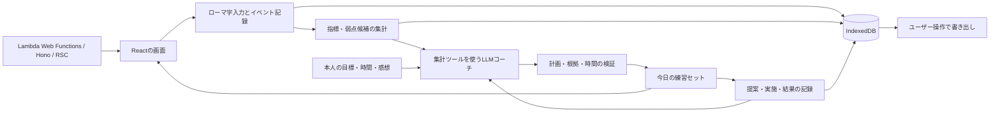

# Typign プロジェクト企画 v0.3

作成日: 2026-10-20。公開資料の調査に基づく初期企画。ユーザーの課題認識、確認済みの外部事実、これから検証する仮説を分けて扱う。

## 企画の結論

**Typignは、日々の入力データをもとに、自分に必要な練習をAIコーチと組み立て、改善を確かめていくパーソナルトレーニングサービス。**

目指す成果は、日本語と英語が混ざる仕事の文章を、少ない打ち直しで入力できること。LLMによる自然言語の対話を、目標の相談、日々のセット作成、結果の振り返りに使う。練習データとコーチの判断を蓄積し、前回の提案がどうだったかを次の提案へ反映する。

トレーニングの柱は、スピード練習、正確性練習、苦手練習、新パターン練習の4種類とする。目的に応じて練習を選び、未見の文章で変化を確かめる。速度の上限、正確さを保てる速度、苦手の定着、新しく覚えた入力を、それぞれの成果として見せる。ホームポジションのガイドも提供する。

Typignという名前は、Typingの`ing`が`ign`になる転置ミスを表す。「ミスを責める」のではなく「自分の癖を知って練習する」というトーンと整合する。名前・ドメイン・商標の利用可能性は未調査。

## 確定した前提と、今回の推奨

| 区分 | 内容 |
| --- | --- |
| ユーザーが指定 | 日本語のローマ字入力を中心に、英単語・記号も練習する |
| ユーザーが指定 | 最初から不特定多数向けにサイトを公開する |
| ユーザーが指定 | ミスや苦手を分析し、個人に合うトレーニングを提供する |
| ユーザーが指定 | 限界速度、正確さを保てる最高速度、苦手の反復・定着、新しいパターンの習得を、トレーニングの柱にする |
| ユーザーが指定 | LLMのパーソナルコーチと学習データを、サービスの中心にする |
| ユーザーが指定 | HonoとAWS Lambda Web Functionsを使う。Next.js等の大きなフレームワークは使わない |
| ユーザーが指定 | Vite / Vite+を基盤に、Async ReactとRSCを活用する |
| ユーザーが指定 | PC前提。白黒を基調に、視認性とエッジの効いたコンポーネントを両立する |
| ユーザーが指定 | サービス側がLLMの推論を提供・負担する構成を避ける |
| 今回の推奨 | 計測・個人データの保存はブラウザを中心にし、LLMは集計ツールを使って説明・提案する |
| 今回の推奨 | MVPから、根拠付きのセット提案、会話による変更、振り返りまでを実装する |
| まだ未確定 | LLMの提供方式の最終決定、対象端末、Web Functionsの実費、公開日、収益化、OSS化 |

無料枠や認証連携の利用資格は、資料確認だけでユーザーのアカウントについて確定できない。

## 誰の、どの場面の課題か

最初の中心ユーザーは、日本語でAIへの指示、仕様、README、レビューコメントを書くWebエンジニア。既にキーボードは使えるが、急ぐと順序の入れ替え、打ち漏らし、英単語や記号への切り替えでつまずく人を想定する。

JTBD: 「考えを文章にするとき、細かな打ち直しで集中を切らしたくない。自分が何を練習すべきか分かり、短い練習で改善を確かめたい。」

「エンジニアの仕事全体が自然言語中心になった」「タイプミスが効率低下の最大要因」という市場全体の事実までは、今回の調査では確認していない。ユーザーから得た問題意識を起点とする。音声入力、予測入力、AIの校正で十分な人もいるため、練習への需要そのものを検証する。

初期の対象外は、競技タイピングの最速層、小児向けの総合教材、かな直接入力、スマートフォン入力、指や目線の自動評価。将来の対応可能性を閉じる意味ではなく、最初の効果検証の対象を揃えるための範囲。

## 競合から分かったこと

適応学習はkeybr、苦手の可視化はe-typing、弱点別レッスンはTypingClubなどが既に提供している。Typing.comはTypeAIとして苦手キーを取り入れた文章生成を発表済み。追加調査では、TypeWPMが個人データによる7日プログラムと、任意の端末内AIによる説明を案内していることも確認した。[競合調査と公式出典](research/competitors.md)

そのため、LLMコーチを中心にするだけで差別化が成立するとは扱わない。Typignでは、根拠を確認しながら練習方針を相談でき、結果が次の提案へつながる体験を具体化する。

差別化の第一仮説は、次の組み合わせである。競合にこの組み合わせが存在しないと証明したものではない。

| 方向 | 提供する価値 | 検証方法 |
| --- | --- | --- |
| 日本語＋英語の仕事文 | 「APIの仕様をREADMEに追記する」など、利用場面に近い文で練習できる | 一般的な単語練習と比べ、練習したい・使いたいと感じるか |
| 根拠を辿れるコーチ | 提案から、対象期間・条件・出題数へ辿れる。ミスの詳細例は保持期間内で確認できる | 本人が提案を理解し、必要なら判断を修正できるか |
| 会話で変えられるセット | 時間、今日の重点、避けたい内容に合わせてセットを組み直す | 固定のおすすめより、自分に合う練習を始めやすいか |
| 計画と結果を結ぶ記録 | 何を狙って練習し、未見文や後日の確認でどう変わったか分かる | 一回の好記録と、条件を揃えた改善を区別できるか |
| 端末内で完結する基本機能 | ログインせず始められ、練習データを自分で保持できる | 開始までの離脱、保存への理解、再訪のしやすさ |

競合との違いは、実際の操作・教材・継続利用で比較する。今回の調査で、他社にこれらの機能が無いと確認できたわけではない。

## コーチは、データと本人の希望から今日のセットを作る

入口にはコーチが提案した練習セットを置き、種類・対象・時間・状態を構造化して表示する。理由は根拠から確認できる。自由なチャットを始めるために、毎回プロンプトを考える必要がない構成にする。

コーチが行うのは、履歴を読む、比較する条件を選ぶ、練習の狙いを決める、セットを提案する、変更希望を受け取る、結果を次回へつなぐこと。会話で決まった時間・重点・対象は、実行できる練習セットとして画面に反映する。

対話例（架空のデータと提案）:

> コーチ: 共通の確認課題で、`ng`を含む40か所のうち8か所に誤り候補がありました。今日はこの並びの苦手練習と、正確性練習を組み合わせます。
>
> ユーザー: 今日は3分だけ。速さより打ち直しを減らしたい。
>
> コーチ: 正確性練習を中心に、合計3分へ変更します。最後に短い別文確認を残します。変更後のセットを確認してください。

本人が承認したセットを開始し、終了後は「狙いに対して何が変わったか」「まだ確認できていないこと」「次回に確かめること」を残す。コーチの文章だけで終わらせず、提案・実施・結果を同じ記録で結ぶ。

## データは、観測・解釈・計画・結果をつなぐ

個人モデルは、専用LLMを追加学習する意味ではない。技能ごとの観測と根拠、本人の目標、練習履歴をまとめた更新可能な状態とする。

| データ | 保持するもの | コーチでの使い方 |
| --- | --- | --- |
| 入力の観測 | 打鍵・修正、教材、配列、表記経路、練習の種類、計測の有効範囲 | ミスや速度を条件別に計算する |
| 技能の記録 | 並び別の件数・率・時間、正確さを保てる速度、保持確認 | 今日の対象と、必要な追加確認を選ぶ |
| 本人の希望 | 目標、使える時間、重視すること、本人の感想 | セットの制約として扱う。観測結果とは区別する |
| 提案と判断 | 計画の版、参照した根拠、変更理由、本人の選択 | なぜその練習をしたかを後から確認する |
| 実施と結果 | 実行した内容、未見文の結果、後日の確認 | 次の提案を更新する |

分析の高度化は、グラフや推定値を増やすことだけを意味しない。「記号への切り替えでミスが増えるのか」「前回の練習が別文でも残っているか」といった問いに、比較できるデータで答えられることを目指す。

数値の計算、比較対象の抽出、サンプル数、計画の時間制約はプログラムで処理する。LLMは、何を比較するかを選び、結果を解釈して仮説と練習案を作る。根拠が足りないときは追加の確認を提案する。モデルに任意のコードやSQLを実行させることは、MVPの前提にしない。

LLMの出力は、根拠ID、教材ID、練習の種類、時間、本人の制約を検査してから提案として使う。本人の感想や希望は確認・編集・削除できるようにし、コーチが覚えている内容を見えないまま増やさない。データの具体的な構造は[技術設計](architecture.md)で整理する。

## 4種類のトレーニングを、目的に応じて選ぶ

4種類はそれぞれ選べるメニューとし、毎回すべてを行う順番には固定しない。名称は仮案、実施方法と評価は現時点の設計案である。

| 種類 | 伸ばしたいこと | 取り組み方の案 |
| --- | --- | --- |
| スピード練習 | 指を動かす速さの上限 | 慣れた短い並びを、限界まで速く打つ。ミスで止めずに続け、試行後に振り返る |
| 正確性練習 | 正確さを保てる最高速度 | 正確さを優先しながら、その条件を保てる範囲で速さを上げる |
| 苦手練習 | つまずく並びの改善と定着 | 苦手な並びを取り出して反復し、単語・文でも打てるか確かめる |
| 新パターン練習 | まだ慣れていない入力の習得 | 入力の並びをガイドで確認し、反復したあと、ガイドを外して再現する |

### 目的ごとに成果の見せ方を変える

スピード練習は、同じ並び・表記での入力速度を主に見る。正しく打てた量と誤りも併記する。ミスは試行を止める条件にせず、対象と無関係な連打やキーリピートを速度記録に含めない。

正確性練習では、正確さの条件を満たした試行の中で最高速度を探る。ゆっくり打ち続けること自体を目標にしない。修正前の誤りも含めて条件を評価し、判定が難しい箇所はその旨を示す。正確さの条件や速度の上げ方は、実際に使いながら決める。

苦手練習の成果は、対象の誤りや修正が減ったか、別の文や後日の練習でも再現できるかで見る。新パターン練習では、ガイドを見て打てる状態から、自力で入力できる状態への変化を記録する。

新パターンは、本人がまだ慣れていないローマ字の並び、英単語、記号の入力などを指す。「未見の評価文」は文章そのものが初めてという意味で、練習した並びを含んでよい。新しく学ぶ対象と、学んだことを確かめる文章を区別する。

### 個別メニューは、練習の種類と対象を提案する

コーチは分析結果と本人の希望から、練習の種類・対象・順番・時間を含むセットを提案する。本人も目的を選び直せるようにする。苦手な並びを速く反復するなど、4種類の目的が重なる場面も扱う。

限界速度で打ったときのミスと、新パターンを覚え始めたときのミスは、練習条件とともに記録する。普段の苦手候補は、診断や共通の確認課題でも再現するかを見て判断する。4種類の記録を一つの総合点へまとめることは、MVPの前提にしない。

各練習の効果、組み合わせ、時間配分は、Typignの利用を通じて検証する。

## 5分メニューは、選んだ練習を中心に組む

次は短いメニューの例である。4種類を毎回5分に詰め込まず、その日の目的に合わせて重点練習を選ぶ。

1. **30秒:** 前回の結果と今日の提案を確認する。必要なら時間や重点を変更する。
2. **60秒:** 同程度の難しさの未見フレーズで、今日の状態を測る。
3. **120秒:** スピード、正確性、苦手、新パターンのいずれかを中心に練習する。
4. **60秒:** 練習の種類によらず条件を揃えた確認課題で、別の文章にも変化が現れるかを見る。
5. **30秒:** コーチと結果を振り返り、次回の確認項目を残す。

初回やサンプル不足では「苦手が確定した」と言わず、候補と試行回数を示す。スピード練習では速さへの挑戦を促し、正確性練習では正確さを保てる速さを探す。各練習は単独でも選べるようにする。5分は体験設計の案で、効果が科学的に最適と確認された長さではない。

コーチ表示例（架空データ）:

> 今回は`ng`を含む40か所のうち8か所で誤り候補がありました。直近2回でも現れているため、今日はこの並びを練習します。まずは急がず、`n → g`の順に打ってみましょう。

表示する指標は観測事実と説明可能な推定に限定する。自由編集や複数の正解表記で判定が曖昧な箇所は、計測できた割合とともに示す。「右手の人差し指が遅い」「脳が先走っている」など、計測していない原因を作らない。

## 追加機能のアイデアと優先順位

| 機能 | 生まれる価値 | 優先順位・理由 |
| --- | --- | --- |
| LLMによるセット提案・相談・振り返り | データと本人の希望から、何をどれだけ練習するか決められる | P0。今回の中心価値。まず一つのLLM方式で通す |
| 提案の根拠と計画・結果の記録 | コーチの判断を確認し、次回へ引き継げる | P0。数値と根拠を画面から辿れる形にする |
| 4種類の目的別トレーニング | 速度上限、正確に打てる速度、苦手の定着、新規習得を練習できる | P0は共通の入力エンジンと小さな教材で構成する案 |
| 誤り→一点練習→未見文の確認 | 自分に必要な練習と、その結果が分かる | P0。価値仮説そのもの |
| 転置候補の短いリプレイ | `ing → ign`を自分で理解できる | P0は文字の並びの表示。凝った再生UIは後回し |
| 日本語・英語・記号の仕事教材パック | 入力の切り替えを含む練習 | P0は小さな監修済みセット |
| ホームポジションの視覚ガイド | 指の置き方を学び直せる | P0は軽い表示。自動判定はしない |
| 条件を揃えた履歴比較 | 単純な前回比より、何が変わったか理解しやすい | P0は件数と条件付き比較。高度な推定・週次要約はP1 |
| 自分の文章を端末内で教材化 | よく書く文章に近づける | P1。読み付け・機密情報・保存制御が必要 |
| 自分のAIへ相談用データをコピー | 運営の推論費なしで相談できる | P1の小さな候補。送る内容を先に確認 |
| コーチの複数モデル対応 | 端末・利用契約に応じて推論方式を選べる | P1。MVPで使う方式の品質を確認してから広げる |
| IMEの変換・確定を含む文書練習 | 実務への近さを高める | P1で別モードとして検証 |
| 会話型の指示・修正シミュレーション | 指示→追加条件→修正文の入力を練習 | P2。文章の作成能力と打鍵技能の評価を分ける |
| クラウド同期・チーム機能・ランキング | 複数端末・組織・競争の需要 | 要需要確認。初期の計測価値を確かめてから |

P0/P1/P2は実装順の提案であり、リリース日や開発期間の約束ではない。

## MVPの範囲

**含める:** 一つのLLM方式によるコーチ、根拠付きのセット提案、時間・重点の会話による変更、結果の振り返り、計画と結果の保存。加えて、4種類の最小トレーニング、ローマ字入力、英字と基本記号、複数の正しい表記、修正の記録、弱点候補、ホームポジションのガイド、履歴、書き出し・復元・削除を含める。

**後に回す:** ChatGPT連携の承認取得を前提とする機能、アカウントと同期、クラウド分析DB、学習と関係のない汎用チャット、生成教材の自動公開、IME変換の誤り分類、他アプリの打鍵収集、カメラによる指や目線の推定。

公開対象は不特定多数だが、初期の動作保証はデスクトップChromeから始める推奨。日本語ローマ字・JIS/US配列をテストする。未対応環境でも説明にたどり着けるようにし、実機確認後に対象を広げる。単にアクセスできることと、精密計測を保証することを分ける。

詳しい完了条件は[MVP仕様](mvp-scope.md)にまとめる。

## 技術構成の推奨

| 層 | 推奨 | 理由 |
| --- | --- | --- |
| 言語 | TypeScript | UI、入力エンジン、分析の型を共通化する |
| UI / 開発基盤 | Async React + RSC、Vite / Vite+ | 非同期UIとRSCを活用し、統合層を小さく保つ。Next.js等は使わない |
| Web/API | Hono + Node.js HTTP server | RSC・HTML・APIを配信し、Lambda Web Functions上で動かす |
| ホスト | AWS Lambda Web Functions + 必要なCloudFront配信 | 動的配信を初期から扱う。静的成果物とキャッシュは分離する |
| 入力・分析 | ブラウザ内の独立モジュール | 通信遅延やサーバー移行を計測から切り離す |
| 保存 | IndexedDB + Dexie | セッション・集計を端末に保存。クラウド契約やログインを不要にする |
| 教材 | バージョン付きJSON | 表示文、読み、許容入力、対象キーを監修できる |
| コーチ | LLM + 集計ツール + 計画検証 | 計算できる根拠から提案し、自然言語でセットを変更できる |
| 検証 | Vitest + Playwright、IMEは実機 | 入力の分岐や修正・保存の境界を確認するための候補 |

RSCのサーバー処理から、利用者のIndexedDBを直接読むことはできない。教材と共通構造はサーバー、打鍵・個人の分析・端末内コーチはブラウザに分ける。Vite+は開発ツールチェーンであり、RSCのルーティングや配信まで自動で完成するわけではない。必要な統合責務と一次資料は[技術設計](architecture.md)にまとめる。

図は推奨設計であり、実装済みの構成ではない。

### AWS開始と、その後

初期の動的ホストは、ユーザー指定のAWS Lambda Web Functionsとする。2026年10月12日のAWS公式発表で、Node.jsのHTTPサーバー、Hono、アダプター不要の起動、ネイティブHTTPストリーミングを確認した。既存Lambdaのイベントハンドラー方式やFunction URLsとは区別する。[AWS公式発表](https://aws.amazon.com/about-aws/whats-new/2026/10/aws-lambda-web-functions/)

従来案の「S3中心で開始し、APIは後から追加」から、Hono + RSCをWeb Functionsで動かす構成へ変更する。CPU待機時間の課金は避けられるが、実消費メモリ、リクエスト、転送等は別の料金要素。従来のLambda無料枠をそのまま適用せず、アカウントと料金表で確認する。[AWSの解説](https://aws.amazon.com/blogs/compute/exploring-aws-lambda-web-functions-for-building-web-applications/)

Cloudflare等への移行候補は残すが、Node.js用RSC成果物まで無変更で移せるとは約束しない。計測・分析・計画検証を共有モジュールにし、ホスト固有部分を起動と配信の境界へ限定する。[技術設計](architecture.md)、[ホスト・DBの比較資料](research/hosting-and-data.md)

ホストの変更でドメインも変える場合、IndexedDBのデータは自動で引き継がれない。公開URLの維持、または旧URLでの書き出し・新URLでの読み込みを、移行計画に含める。[ブラウザストレージの仕様](https://developer.mozilla.org/en-US/docs/Web/API/Storage_API/Storage_quotas_and_eviction_criteria)

### LLMとデータベース

LLMコーチはMVPの中心へ変更する。一方、運営側で推論費を負担しない方針は維持する。現時点では端末内LLMを第一候補とし、持込API等を含む提供方式の最終決定は別途行う。対応端末と日本語での計画作成品質を、実装初期に確かめる。[LLM方式の調査](research/llm-options.md)

LLM未対応・失敗時は標準セットと記録を使えるようにする。ただしその状態をAIコーチの提供完了とは扱わない。コーチ体験を検証せずに、AIを中心とする公開MVPが完成したとは判断しない。

データを中心にすることと、クラウド分析DBを最初から持つことは別の判断である。MVPではブラウザ内の履歴・集計・計画を重視し、条件付き比較を実装する。大量履歴の任意分析や同期が必要になった時点で、分析エンジンやサーバーDBを再評価する。

## UIは機能名・データ・操作を中心にする

計画・実施・結果を残すトレーニングノートを内部のメンタルモデルとし、画面名には「セット」「練習」「記録」「分析」などの機能名を使う。PCの広さを、提案されたセット・指標・根拠を見比べるために使う。

タグライン、文章調の見出し、挨拶、励ましの装飾文はアプリUIに表示しない。重点・対象・時間・状態を短いラベルと値で示す。コーチによる自然言語は相談、選択した根拠の説明、結果の振り返りで使い、通常画面に常設する紹介文にはしない。

白黒を基調に、余白と文字の階層で視認性を作る。枠や硬い影は、開始ボタン、選択中の項目、セットのまとまりへ絞って使う。データ表示は静かにし、派手なゲーミング表現を使わない。配置・画面遷移・デザイン値は[UI設計方針](design-direction.md)を参照。

## 本当に価値があるかの検証

中心となる成果は、**本人が納得して練習を選べ、未見の仕事に近い教材で、入力速度を大きく犠牲にせずミスと修正負荷が減ること。** 提案への納得、実行しやすさ、計測された変化をそれぞれ確かめる。

1. **問題の確認:** 日本語でAI指示や文書を書く人5〜8名に、どこでミスするか、直す負担、既存の対処、練習を続ける理由を聞く。実際の業務文の提出は求めない。
2. **最初の実用性:** 開発者自身の数日分の利用で、計測の誤判定、教材の不自然さ、保存・復元を確かめる。
3. **公開β:** 公開サイトで10〜20名程度の協力者を募る想定。最初は傾向を知るための試験で、統計的な効果保証とは扱わない。
4. **学習効果の探索:** 2週間程度、同じ練習時間で個別メニューと標準メニューを比べる。参加者の開始時点の水準を考慮して割り付け、未見教材を使う。
5. **実務への転移:** IMEを使う短い模擬文書課題でも修正負荷が変わるか、別に確認する。ローマ字練習の伸びをそのまま実務効率と呼ばない。

コーチの価値は、根拠を辿れるか、希望どおりにセットを変えられるか、次回の提案が履歴を引き継ぐかで確認する。学習効果は未見テストの修正量と速度を併せて見る。数値の合格ラインは実験前に固定し、小規模なβの限界と効果の無かった人も報告する。

端末内保存を標準にするため、運営者は利用者の学習データを当然には受け取れない。調査参加者には、集計内容を見てから任意で結果を書き出してもらう。匿名でも横断計測を後から入れる場合は、目的と送信項目を別に設計する。

## 次の判断と着手順

1. Web Functions + Hono + Vite RSCの本番ビルドと、端末内LLMの日本語コーチを、小さく別々に検証する。
2. 入力計測と根拠付き集計を作り、小さな教材でコーチの提案・変更・練習・振り返りを一周させる。
3. 計画と結果の記録、保存・復元、未対応環境の案内を備えて公開βにする。
4. 利用者の反応と未見テストを基に、教材・分析・説明を改善する。
5. 高度な分析、IME実務モード、同期、複数モデル対応のうち、次に価値を増やすものを判断する。

実装前に確認すべき運用情報は、AWSアカウントの特典の期限・残額、独自ドメインの有無、許容する月額上限。これらが分からなくても、企画とローカルの技術検証は進められる。

## 関連資料

- [MVPの範囲と受け入れ条件](mvp-scope.md)
- [技術設計と検証項目](architecture.md)
- [UI設計方針](design-direction.md)
- [競合調査](research/competitors.md)
- [学習・計測の調査](research/learning-and-measurement.md)
- [ホスティングとデータの調査](research/hosting-and-data.md)
- [LLM連携の調査](research/llm-options.md)
